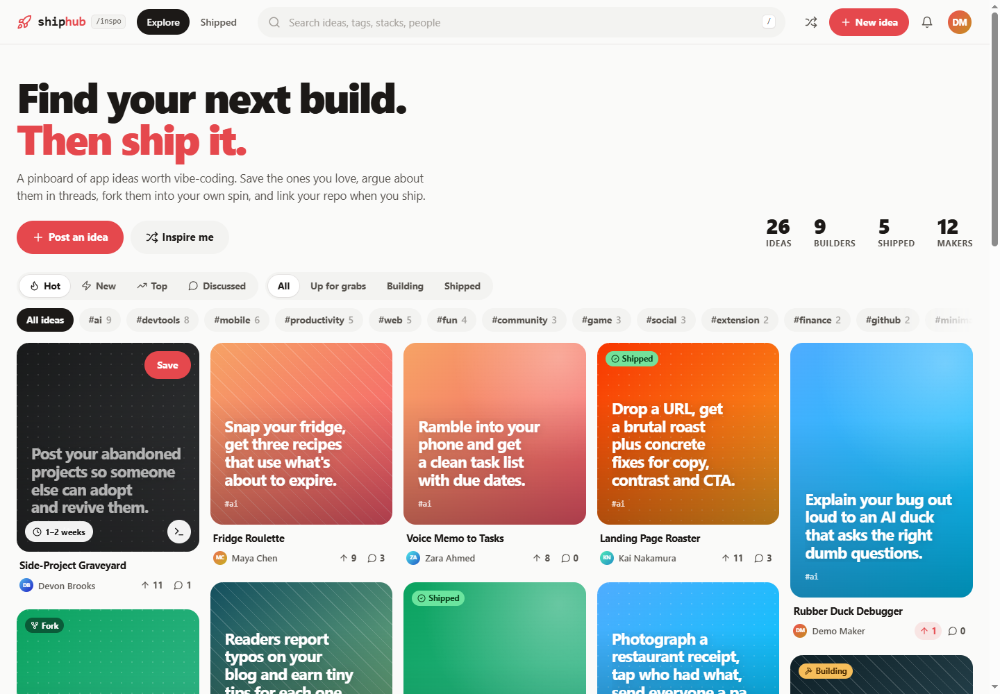
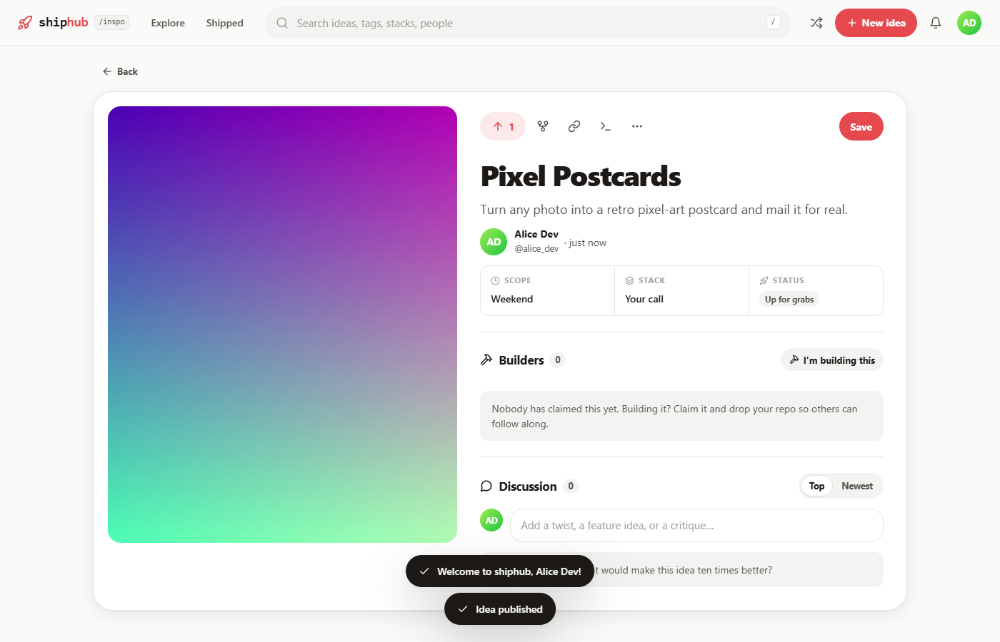
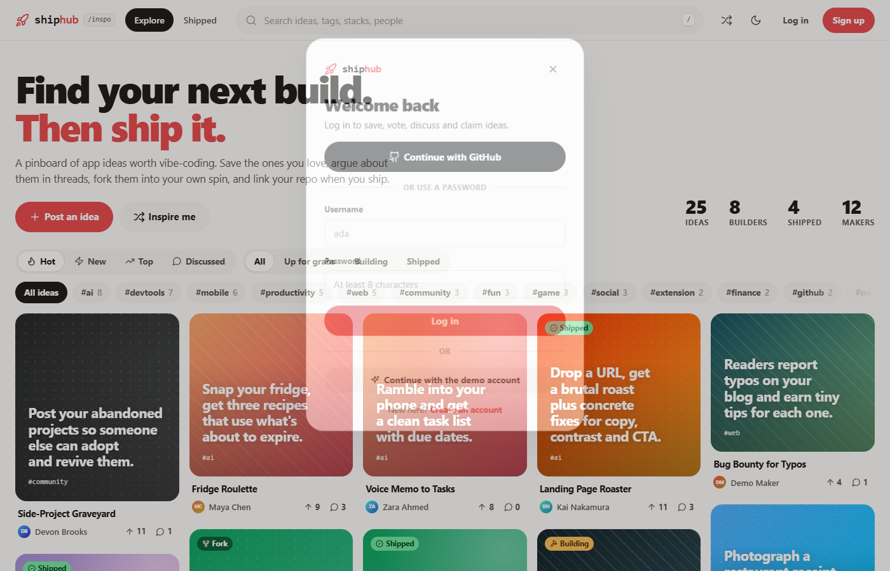
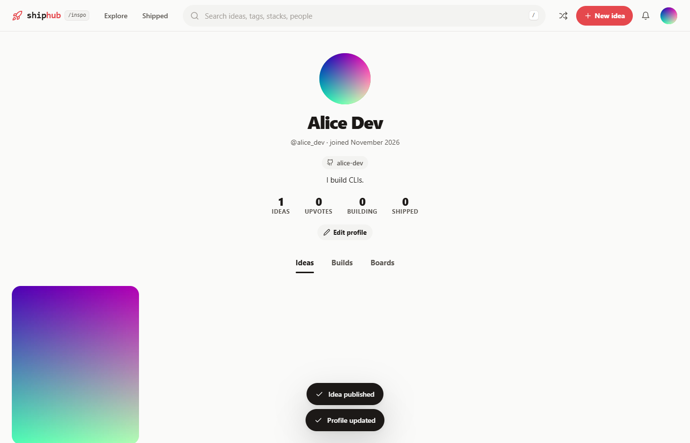

# shiphub

A Pinterest-style board of app ideas worth building, with forum threads,
builders ("I'm building this" → shipped, with repo + demo links), forks,
boards, notifications, GitHub sign-in and image uploads.



| Idea page | GitHub sign-in | Profile with uploaded photo |
| --- | --- | --- |
|  |  |  |

## HQ: the vibe-coder side of shiphub

shiphub has a built-in **HQ** tab (`#/hq`) for vibe coders. It is the same app, database, account,
notification bell and profile, with no second server:

- **Feed**: post ships, tips and news. A ship linked to a GitHub repo you own gets a ✓ verified badge
  (needs GitHub sign-in).
- **Ladder**: XP from posting, likes, friends, finished agent tasks, sales, and idea-board actions
  (new ideas, comments, shipped builds). Daily caps stop farming. You can view the ladder globally,
  by country or among friends, for all time or this week.
- **Agents**: add a device, run `agent.py` on it, then send `ping`, `sysinfo` and `list_agents`, or
  PIN-protected `agent_task` (for example `claude -p ...`) and `shell` commands, from your browser or phone.
- **Chat**: a world channel, plus DMs between friends. **Friends**: search people, send and accept requests.
- **Market**: sell prompts, templates and tools. Payments go through Stripe Connect when it's configured;
  without Stripe the market runs in demo mode, so purchases complete instantly with no real charge.
- **Settings**: country and stack, command PIN, active sessions ("sign out everywhere"), password,
  phone push (install the site as an app) and an optional ntfy.sh topic.

HQ stats also show on every profile (`#/u/<name>/hq`). The vibeHQ idea is listed on the owner's **Builds**
tab (`SHIPHUB_OWNER`, default `juw12`; leave it empty to turn that off).

### Connect a device

In HQ → Agents → **Add device**, copy the key (shown once), then on that machine run:

```
python agent.py --server https://YOUR-SITE --key shd_xxx
python agent.py --server https://YOUR-SITE --key shd_xxx --allow-agent --agent-cmd "claude -p" --workdir C:\code\myapp
```

Agent tasks and shell commands are **off unless enabled on the device itself** (`--allow-agent`,
`--allow-shell`, optionally `--shell-allow "git status,npm test"` and `--approve`). They also need the
account's command PIN, and 5 wrong PINs lock remote commands for 15 minutes. Every command is written
to `shiphub-agent-audit.log` next to `agent.py`. You can also set the server and key with the
`SHIPHUB_SERVER` and `SHIPHUB_DEVICE_KEY` environment variables.

### HQ settings (environment or `config.env`)

| Variable | What it does |
| --- | --- |
| `STRIPE_SECRET_KEY` | Turns on real payments (Stripe Connect Express payouts to sellers). |
| `STRIPE_WEBHOOK_SECRET` | Signing secret for the webhook at `https://YOUR-SITE/api/hq/stripe/webhook` (event `checkout.session.completed`, plus `account.updated` for Connect). |
| `PLATFORM_FEE_PERCENT` | Your cut of each sale (default 10). |
| `CURRENCY` | Checkout currency (default `usd`). |
| `GITHUB_CLIENT_ID` / `GITHUB_CLIENT_SECRET` | GitHub sign-in, which also enables verified ships and GitHub push XP. |
| `GITHUB_TOKEN` | Optional token for higher GitHub API limits when verifying repos. |
| `NTFY_BASE` | ntfy server for the optional ntfy push (default `https://ntfy.sh`). |
| `VAPID_SUBJECT` | Contact for Web Push (`mailto:you@example.com`). The VAPID key is generated once and stored in the database. |
| `PUSH_EXTRA_HOSTS` | Extra allowed push-service hosts (comma separated) beyond the built-in browser push services. |
| `SHIPHUB_OWNER` | Whose profile lists the vibeHQ build (default `juw12`). |

Tests: `python tests/test_hq.py` starts a throwaway server and checks the feed, likes, XP, friends,
chat/DMs, devices, `agent.py --once`, the command PIN lockout, demo purchases, the live stream,
sessions and password changes.

## Run it locally

Double-click `start.bat`, or:

```
python server.py
```

It opens http://127.0.0.1:8000 (or the next free port). Demo login: `demo` / `demo1234`.
Nothing to install: locally it uses SQLite in `data/shiphub.db`.

Useful flags: `--host 0.0.0.0` (share on your Wi-Fi), `--reset` (wipe + re-seed), `--no-browser`.

## Configuration

Copy `config.example.env` to `config.env` and fill in what you need. Environment
variables override the file. The important ones:

| Variable | What it does |
| --- | --- |
| `GITHUB_CLIENT_ID`, `GITHUB_CLIENT_SECRET` | Turns on "Continue with GitHub" |
| `DATABASE_URL` | `postgresql://…` to use Postgres instead of SQLite (`pip install -r requirements.txt`) |
| `PUBLIC_URL` | Your public `https://…` address (secure cookies, GitHub redirects) |
| `SHIPHUB_ADMINS` | Comma-separated usernames that can delete any idea or comment |
| `SHIPHUB_DEMO` | `1` locally; set `0` on a public site (sample accounts get random passwords, demo button hidden) |
| `SHIPHUB_MAX_UPLOAD_MB` | Upload limit for covers/avatars (default 5) |
| `TRUST_PROXY` | `1` behind Fly/Render/nginx so rate limits see the real client IP |

## GitHub sign-in

1. Go to https://github.com/settings/developers → **New OAuth App**.
2. Homepage URL: `http://127.0.0.1:8000` (or your public URL).
3. Authorization callback URL: `http://127.0.0.1:8000/auth/github/callback`
   (deployed: `https://YOUR-DOMAIN/auth/github/callback`).
4. Put the Client ID and a generated Client secret in `config.env` (or your host's secrets) and restart.

Signing in with GitHub creates an account (username from your GitHub login, plus
name, bio and avatar). Already have a password account? Use **Edit profile →
Connect your GitHub account** to link it.

## Image uploads

Cover images (button, drag-and-drop or paste in the composer) and profile photos.
The browser shrinks big photos to WebP before upload. The server accepts
PNG/JPEG/GIF/WebP only (checked by file signature, not the filename), stores them in
the database and serves them from `/uploads/…` with long cache headers and a
sandbox CSP.

## Deploy

The repo includes a `Dockerfile` (works on any Docker host), `render.yaml` and `fly.toml`.

**Render (free to start, easiest):** push this folder to a GitHub repo → Render
dashboard → **New → Blueprint** → pick the repo. It creates the web service and a
Postgres database. Then set `GITHUB_CLIENT_ID`, `GITHUB_CLIENT_SECRET` and
`SHIPHUB_ADMINS` in the service's Environment tab.
Notes: free web services sleep after ~15 min idle (first visit takes a moment);
free Postgres expires after 30 days unless you upgrade.

**Fly.io (about $2–3/month, no free tier for new accounts):**

```
fly launch --copy-config --no-deploy     # pick a unique app name
fly volumes create shiphub_data --size 1
fly secrets set GITHUB_CLIENT_ID=... GITHUB_CLIENT_SECRET=... SHIPHUB_ADMINS=yourname
fly deploy
```

This keeps SQLite on the volume. For Postgres instead, set a `DATABASE_URL` secret.

Health check: `GET /healthz`.

## What's inside

- `hq.py`: the HQ API (feed, ladder, friends, chat, devices/agents, market, push) on the same database.
  `agent.py` is the device bridge; `stripe_client.py`, `github_client.py` and `webpush.py` are small stdlib clients.
- `server.py`: Python standard-library HTTP server + JSON API. SQLite or Postgres (same SQL, rewritten for Postgres).
  PBKDF2 passwords, HttpOnly session cookies, CSRF protection, rate limits on logins and writes, strict CSP, gzip + ETags.
  Old SQLite databases are upgraded automatically on startup.
- `static/`: framework-free single-page app (`index.html`, `app.js`, `hq.js`, `app.css`, `theme.js`),
  plus `sw.js` and `manifest.webmanifest` so phones can install it and get push notifications.

## Not done yet

Password reset by email, reporting/flagging content, and email notifications.
